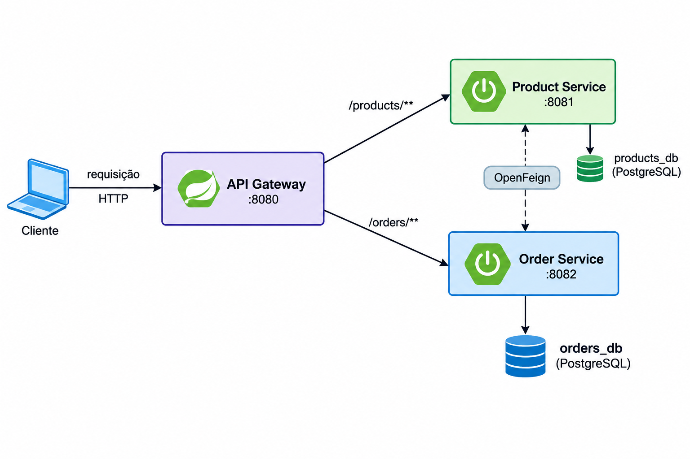

# Mini E-commerce — Microsserviços

Aplicação backend de um mini e-commerce desenvolvida utilizando arquitetura de microsserviços, com foco em comunicação síncrona entre serviços através do **Spring Cloud OpenFeign**.

O projeto permite cadastrar e consultar produtos, criar pedidos e gerenciar reservas de estoque, mantendo responsabilidades e persistência independentes em cada serviço.

## Arquitetura

A aplicação é composta por três serviços:

- **API Gateway:** ponto de entrada das requisições externas, responsável pelo roteamento para os serviços.
- **Product Service:** responsável pelo gerenciamento de produtos, controle de estoque e reservas.
- **Order Service:** responsável pela criação, consulta, confirmação e liberação de pedidos.

A comunicação entre Order Service e Product Service é realizada de forma síncrona utilizando Spring Cloud OpenFeign.

### Diagrama



Cada microsserviço possui seu próprio banco de dados PostgreSQL, evitando o compartilhamento direto de entidades e estruturas de persistência.

## Tecnologias utilizadas

- Java 21
- Spring Boot
- Spring Cloud Gateway (Server WebMVC)
- Spring Cloud OpenFeign
- Spring Data JPA
- Hibernate
- PostgreSQL 16
- Docker
- Docker Compose
- Maven
- Lombok
- Jakarta Bean Validation
- JUnit 5
- Mockito

## Estrutura dos serviços

### API Gateway

Responsável por centralizar o acesso às APIs e encaminhar as requisições para os respectivos microsserviços.

| Rota | Destino |
|---|---|
| `/products/**` | Product Service |
| `/orders/**` | Order Service |

Porta: `8080`.

As rotas internas de reservas não são disponibilizadas pelo Gateway.

### Product Service

Responsável pelo gerenciamento do catálogo de produtos e controle de estoque.

**Funcionalidades:**

- Cadastro de produtos.
- Consulta de produto por identificador.
- Listagem de produtos.
- Criação de reservas de estoque.
- Confirmação de reservas.
- Liberação de reservas.
- Controle de disponibilidade considerando as reservas existentes.

Porta: `8081`.

Banco de dados: `products_db`.

### Order Service

Responsável pelo gerenciamento dos pedidos e comunicação com o Product Service.

**Funcionalidades:**

- Criação de pedidos.
- Consulta de pedidos por identificador.
- Confirmação de pedidos.
- Liberação de pedidos.
- Solicitação de reservas de estoque através do OpenFeign.
- Tratamento de erros provenientes do serviço dependente.

Porta: `8082`.

Banco de dados: `orders_db`.

## Regras de negócio

### Produtos e estoque

- Cada produto possui nome, descrição, preço e quantidade disponível.
- Não é permitido cadastrar produtos com nomes duplicados.
- A quantidade solicitada em uma reserva deve ser maior ou igual a 1.
- O estoque disponível é calculado considerando as reservas ACTIVE e CONFIRMED.
- Reservas RELEASED deixam de comprometer o estoque.
- O controle de concorrência utiliza bloqueio pessimista (`PESSIMISTIC_WRITE`) durante a criação de reservas.

### Pedidos

- Todo pedido possui um identificador UUID.
- A criação de um pedido exige uma reserva de estoque bem-sucedida.
- Cada pedido está associado a um produto e a uma reserva.
- O preço unitário e o valor total são registrados no momento da criação do pedido.
- Um pedido só pode ser confirmado ou liberado quando estiver no estado PENDING.

### Estados dos pedidos

| Estado | Descrição |
|---|---|
| `PENDING` | Pedido criado e aguardando confirmação ou liberação. |
| `CONFIRMED` | Pedido confirmado. |
| `RELEASED` | Pedido liberado e reserva de estoque liberada. |

### Estados das reservas

| Estado | Descrição |
|---|---|
| `ACTIVE` | Reserva criada e aguardando confirmação ou liberação. |
| `CONFIRMED` | Reserva confirmada e ainda comprometendo o estoque. |
| `RELEASED` | Reserva liberada e sem comprometimento do estoque. |

## Fluxos de negócio

### Criação de pedido

1. O cliente envia uma solicitação de criação de pedido ao Order Service.
2. O Order Service gera um UUID para o pedido.
3. O Order Service solicita ao Product Service a reserva do produto através do OpenFeign.
4. O Product Service verifica a existência do produto e a disponibilidade do estoque.
5. Caso exista disponibilidade, uma reserva ACTIVE é criada.
6. O Product Service retorna os dados da reserva, incluindo preço unitário e valor total.
7. O Order Service utiliza os dados recebidos para persistir o pedido com estado PENDING.

### Confirmação de pedido

1. O Order Service consulta o pedido.
2. Verifica se o estado atual é PENDING.
3. Solicita ao Product Service a confirmação da reserva.
4. O pedido passa para o estado CONFIRMED.

### Liberação de pedido

1. O Order Service consulta o pedido.
2. Verifica se o estado atual é PENDING.
3. Atualiza o pedido para RELEASED.
4. Solicita ao Product Service a liberação da reserva.
5. A reserva passa para o estado RELEASED.

## Endpoints

Todas as rotas públicas são acessadas através do API Gateway, na porta `8080`.

### Product Service

| Método | Endpoint | Descrição |
|---|---|---|
| POST | `/products` | Cadastrar produto |
| GET | `/products` | Listar produtos |
| GET | `/products/{productId}` | Consultar produto |

**Cadastro de produto**

`POST /products`

```json
{
  "name": "Mechanical Keyboard",
  "description": "Mechanical keyboard with RGB lighting",
  "price": 249.90,
  "availableQuantity": 50
}
```

### Order Service

| Método | Endpoint | Descrição |
|---|---|---|
| POST | `/orders` | Criar pedido |
| GET | `/orders/{orderId}` | Consultar pedido |
| POST | `/orders/{orderId}/confirm` | Confirmar pedido |
| POST | `/orders/{orderId}/release` | Liberar pedido |

**Criação de pedido**

`POST /orders`

```json
{
  "productId": "UUID_DO_PRODUTO",
  "quantity": 2
}
```

Exemplo de resposta:

```json
{
  "orderId": "UUID_DO_PEDIDO",
  "productId": "UUID_DO_PRODUTO",
  "reservationId": "UUID_DA_RESERVA",
  "quantity": 2,
  "unitPrice": 249.90,
  "totalPrice": 499.80,
  "status": "PENDING",
  "createdAt": "2026-11-25T14:00:00"
}
```

**Confirmação de pedido**

`POST /orders/{orderId}/confirm`

Não exige corpo na requisição.

**Liberação de pedido**

`POST /orders/{orderId}/release`

Não exige corpo na requisição.

### Endpoints internos

O Product Service possui endpoints destinados à comunicação entre microsserviços:

| Método | Endpoint | Descrição |
|---|---|---|
| POST | `/internal/products/{productId}/reserve` | Criar reserva |
| POST | `/internal/reservations/{reservationId}/confirm` | Confirmar reserva |
| POST | `/internal/reservations/{reservationId}/release` | Liberar reserva |

Essas rotas são utilizadas pelo Order Service através do OpenFeign e não são encaminhadas pelo API Gateway.

## Tratamento de exceções

Os serviços possuem tratamento centralizado de exceções utilizando `@RestControllerAdvice`.

Entre os cenários tratados estão:

- Produto não encontrado.
- Pedido não encontrado.
- Reserva não encontrada.
- Estoque insuficiente.
- Produto já cadastrado.
- Pedido em estado inválido para confirmação ou liberação.
- Dados de requisição inválidos.
- Falhas de comunicação entre microsserviços.

O Order Service também diferencia erros HTTP provenientes do serviço dependente e trata falhas de comunicação, retornando respostas apropriadas.

## Como executar o projeto

### Pré-requisitos

- Docker.
- Docker Compose.

JDK 21 e Maven são necessários caso queira executar os testes ou iniciar os serviços localmente, fora dos containers.

### 1. Clonar o repositório

```bash
git clone URL_DO_REPOSITORIO
cd mini-e-commerce
```

### 2. Construir as imagens e iniciar a aplicação

Na raiz do projeto, execute:

```bash
docker compose up -d --build
```

O Docker Compose é responsável por construir as imagens e iniciar os containers dos microsserviços e dos respectivos bancos de dados.

Cada microsserviço possui seu próprio Dockerfile, utilizado na construção de sua imagem.

### 3. Verificar os containers

Para verificar o estado dos containers:

```bash
docker compose ps
```

Para acompanhar os logs:

```bash
docker compose logs -f
```

### 4. Acessar a aplicação

As APIs públicas são acessadas através do API Gateway:

```text
http://localhost:8080
```

Portas utilizadas:

| Serviço | Porta |
|---|---:|
| API Gateway | 8080 |
| Product Service | 8081 |
| Order Service | 8082 |
| PostgreSQL - Products | 5438 |
| PostgreSQL - Orders | 5439 |

### 5. Encerrar a aplicação

Para parar e remover os containers e a rede criada pelo Compose:

```bash
docker compose down
```

Os volumes persistentes, caso configurados, não são removidos por esse comando.

### 6. Executar os testes

Cada serviço possui seus próprios testes.

Dentro de cada módulo, execute:

```bash
mvn test
```

Os testes automatizados utilizam JUnit e Mockito para verificar comportamentos e regras de negócio.

## Decisões e limitações arquiteturais

- Cada microsserviço possui seu próprio banco de dados.
- A comunicação entre Order Service e Product Service é síncrona, utilizando OpenFeign.
- Não existe compartilhamento direto de entidades entre os serviços.
- As transações locais de cada serviço não garantem atomicidade entre bancos distintos.
- O projeto não implementa Saga ou mecanismos de compensação distribuída.
- O Docker Compose é responsável pela construção e inicialização dos containers da aplicação, incluindo os microsserviços e seus respectivos bancos de dados.

## Objetivo de aprendizado

Este projeto foi desenvolvido com o objetivo de aprofundar conhecimentos em desenvolvimento backend Java e arquitetura de microsserviços, explorando principalmente:

- Separação de responsabilidades entre serviços.
- Comunicação síncrona utilizando Spring Cloud OpenFeign.
- Persistência independente por microsserviço.
- Modelagem de estados e regras de negócio.
- Gerenciamento de reservas de estoque.
- Controle de concorrência com JPA.
- Tratamento de exceções e falhas de comunicação.
- Testes unitários com JUnit e Mockito.
- Containerização de aplicações utilizando Docker e Docker Compose.

---

**Projeto desenvolvido para fins de estudo e prática de desenvolvimento backend com Java e Spring Boot.**